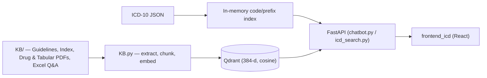

# 🔎 ICD-10 Search & Knowledge Base Backend

FastAPI backend for searching and navigating the **ICD-10-CM** code set. It also builds a **Qdrant vector knowledge base** from official ICD-10 guidelines, indexes, and tabular data, which a RAG-based medical coding assistant uses for retrieval.

It is the backend for [frontend_icd](https://github.com/parvatkhattak/frontend_icd) and is related to [Medical-Coding-Assistant](https://github.com/parvatkhattak/Medical-Coding-Assistant).


---

## ✨ Features

- **Fast code lookup**: in-memory code and prefix indexes with LRU caching for low-latency ICD-10 code search.
- **Hierarchical term navigation**: browse the alphabetic index by letter, term, and child terms.
- **Code details and children**: fetch a code's metadata and its sub-codes.
- **Vector knowledge base**: PDFs and Excel files are chunked, embedded with `all-MiniLM-L6-v2` (384-dim), and stored in Qdrant with cosine similarity. Documents that were already processed are skipped.
- **Data tooling**: converts CSV to hierarchical JSON so that ICD datasets can be loaded.

## 🧭 API

| Method | Endpoint | Description |
|---|---|---|
| `GET` | `/api/search` | Search index terms |
| `GET` | `/api/term` | Get details for a term |
| `GET` | `/api/term-children` | Get child terms for a term path |
| `GET` | `/api/code/{code}` | Get details for an ICD-10 code |
| `GET` | `/api/code-children` | Get sub-codes of a code |
| `GET` | `/api/lookup_code/{code}` | Prefix-based code lookup (`limit` default 20) |
| `GET` | `/search/{code}` | Cached code search (router in `icd_search.py`) |
| `GET` | `/reload-icd-data` | Reload ICD-10 data into memory |

## 🏗️ Architecture



## 📁 Project Structure

```
├── chatbot.py               # FastAPI app — term/code search & navigation endpoints
├── icd_search.py            # Cached code search router + data loading
├── KB.py                    # Knowledge-base ingestion into Qdrant
├── create_collection.py     # Creates / recreates Qdrant collections
├── csv_to_json_converter.py # CSV → hierarchical JSON
├── icd10-index.json         # ICD-10 index data
└── KB/                      # Source documents (guidelines, indexes, Q&A)
```

## 🚀 Getting Started

```sh
git clone https://github.com/parvatkhattak/ICD_search.git
cd ICD_search
python -m venv .venv && source .venv/bin/activate
pip install -r requirements.txt
```

Create a `.env` file:

```env
QDRANT_URL=https://<your-qdrant-instance>
QDRANT_API_KEY=<your-key>
ICD10_INDEX_PATH=icd10-index.json
ICD10_UPDATED_PATH=KB/ICD10_updated.json
```

Run:

```sh
python create_collection.py   # one-time: create Qdrant collection
python KB.py                  # ingest knowledge base
uvicorn chatbot:app --reload  # start API at http://localhost:8000
```

Interactive docs are served at http://localhost:8000/docs.

---

Built by [Parvat Khattak](https://github.com/parvatkhattak) during the Generative AI internship at Brix AI.
